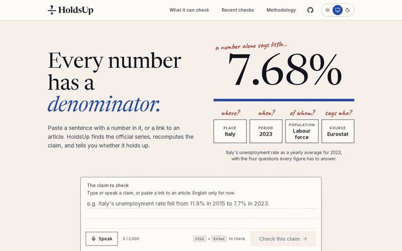
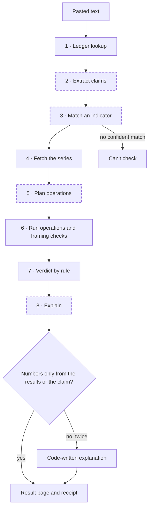
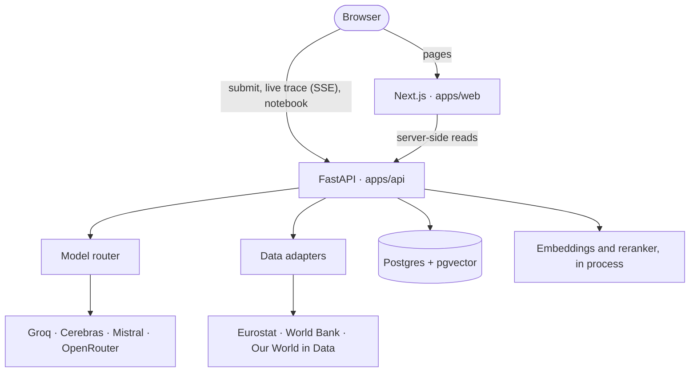

<h1>
  <picture>
    <source media="(prefers-color-scheme: dark)" srcset="brand/holdsup-logo-dark.svg">
    
  </picture>
</h1>

_Every number has a denominator._

HoldsUp audits statistical claims. Paste a sentence with a number in it, such as _"Italy's youth unemployment has halved since 2015"_, or a link to an article. HoldsUp finds the official statistic behind the claim and recomputes it from the raw series with plain code. It then tests whether the framing is fair and gives you a verdict with a receipt you can rerun yourself.

> **Live at [holdsup.vercel.app](https://holdsup.vercel.app), and on Telegram as [@HoldsUpBot](https://t.me/HoldsUpBot).** It runs on free tiers: the first check after a quiet spell waits a few seconds while the API starts, and when the day's free model quota runs out the site says so and still shows finished checks. [Benchmark results](#results-on-the-held-out-split) are below.

<p align="center">
  
</p>

## Why

When UNICEF tested six language models on questions about development indicators, they averaged 21.2% accuracy ([TechCrunch](https://techcrunch.com/2026/09/17/un-turns-to-google-to-make-its-global-data-ready-for-ai-agents/)). Figures in the news get repeated without the series behind them. A general chatbot checks them with arithmetic done in prose, and its answer can change from one try to the next.

HoldsUp does the opposite. It uses the official series, computes the figure in code, and returns the same answer every time. It also runs framing checks nobody asked for, and every check has a page you can link to.

## What a check returns

- **A verdict** from fixed rules and stated tolerances: _Holds up_, _Holds up, but the framing matters_, _Partly holds up_, _Does not hold up_ or _Can't check_.
- **A chart** of the series the claim is about.
- **A cherry-pick heatmap.** It reruns the claim's own calculation for every start and end the series allows, to show whether the claim's direction depends on the window someone picked.
- **Framing checks**:
  - a start or end that carries the claim because it sits at a peak, a trough or a turn in the trend (change points found with [ruptures](https://github.com/deepcharles/ruptures))
  - per capita compared with a raw total
  - real compared with nominal money
  - percentage points compared with percent
  - a definition that differs from the claim's (age ranges, for example)
  - data that is out of date
- **A receipt** listing the source, the series code, the date the data was fetched and a fingerprint of the data. It also shows every calculation step, and the provider and model behind each model step.
- **A Jupyter notebook** that repeats every calculation from the values it read. It needs only Python 3.10 or later: no HoldsUp code and no network.
- **An embeddable verdict.** "Copy embed code" gives an iframe that shows the claim, its verdict and its figures on another site, with a link to the full receipt. HoldsUp draws it from the stored check each time it loads.
- **A Telegram bot, [@HoldsUpBot](https://t.me/HoldsUpBot).** Send it a sentence with a figure, or a link to an article, in a private chat. It answers with each claim's verdict and explanation and a link to the full receipt, from the same pipeline as the site.
- **A claim watch.** Every day, `make watch` (run by a GitHub Actions schedule) reruns each stored check's plan on the sources' current data, cut where the check read it, so later releases never count. When a source has revised a figure, HoldsUp publishes an updated check. The old receipt stays as it was and points to the update, and the embed shows the update. No model is asked.

## How it works

### The rule: the model never computes a number you see

Language models do the parts that need language: reading the claim, picking the statistic and wording the explanation. They never produce a figure.

- **Extract:** the model turns text into a structured spec, checked with Pydantic.
  - Example: indicator phrase "youth unemployment", place `IT`, from 2015 to the latest year, asserted change "halved".
- **Plan:** the model chooses named operations from a fixed registry (`value_at`, `change`, `cagr`, `trend`, `compare`, `rank`, `per_capita`, `deflate`) and their arguments. It outputs a plan, never a value.
- **Compute:** code runs every plan. All arithmetic lives in [`apps/api/holdsup/ops/`](apps/api/holdsup/ops) as pure, typed functions with full line coverage and property tests.
- **Verdict:** rules compare the computed value with the asserted one, within the tolerances in [`verdict/tolerances.yaml`](apps/api/holdsup/verdict/tolerances.yaml).
- **Explain:** the model writes two or three sentences from the computed results only. A post-check reads every numeral in the text and rejects the explanation if one is in neither the results nor the claim. After two rejected tries, a code-written explanation replaces it.

### The pipeline



Dashed steps call a language model. Every other step is deterministic code.

- **Ledger lookup:** a claim checked before returns its stored result with no model call.
- **Matching:** it starts with vector search over the catalog (top 8) and the reranker. The model picks only when the reranker's margin is narrow, with at most 4 tool calls.
- **Streaming:** the API sends each step to the browser as Server-Sent Events (`step_started`, `step_done`, `result`, `error`), so you watch the check happen.

### The system



- **Model router** ([`apps/api/holdsup/router/`](apps/api/holdsup/router)): every model call goes through it.
  - It tracks each provider's free-tier budget and moves to the next provider on a rate limit, an error or invalid output.
  - A circuit breaker rests a provider that keeps failing.
  - When all providers are out, the site says it is at capacity and offers finished checks to read.
  - Gemini is used only offline, for evaluation and training data, never for live users.
- **Catalog** ([`packages/catalog/`](packages/catalog)): 80 hand-checked indicators. Each has its aliases, a one-sentence definition, its unit and its related series (the per-capita and real versions, for example). It is embedded for vector search in Postgres.
- **Reranker:** a cross-encoder fine-tuned on the benchmark's dev split and served with onnxruntime. Its training is in [`ml/`](ml) and its card is [`ml/reranker/MODEL_CARD.md`](ml/reranker/MODEL_CARD.md). It is published on the [Hugging Face Hub](https://huggingface.co/sinahatami/holdsup-reranker).
- **Hosting:** free tiers only, in one region (N. Virginia): the web app on Vercel, the API in a Docker container on Google Cloud Run, and Postgres on Neon.

## Evaluation

The benchmark is 150 hand-labelled texts with real numeric claims ([`eval/`](eval)).

- 106 texts form the **dev split**, used for every threshold, tolerance and training choice.
- 44 texts are **held out** and run once, at the end.
- The same claims also go to a plain chatbot, for a head-to-head comparison.
- A 30-claim smoke subset runs on every pull request that can change a verdict. It fails if verdict accuracy drops by more than 5 points.

### Results on the held-out split

HoldsUp ran the 44 held-out texts once, after every choice had been fixed on dev. The chatbot is GPT-OSS 120B on Groq, given one plain prompt per text with no tools and no web search, and asked for the same five verdicts.

| 44 held-out claims                              |           HoldsUp |      Plain chatbot |
| ----------------------------------------------- | ----------------: | -----------------: |
| **Verdict right**                               | **39 / 44 (89%)** | **17 / 44 (39%)** |
| Labelled _Holds up_                             |           16 / 16 |             8 / 16 |
| Labelled _Holds up, but the framing matters_    |             6 / 9 |              1 / 9 |
| Labelled _Does not hold up_                     |           12 / 12 |             7 / 12 |
| Labelled _Partly holds up_                      |             2 / 3 |              0 / 3 |
| Labelled _Can't check_                          |             3 / 4 |              1 / 4 |
| Model calls per claim                           |               5.1 |                1.6 |
| Seconds per claim                               |              18.6 |                3.6 |

- **Each HoldsUp step:**
  - Extraction found all 44 claims and nothing else.
  - Matching put the right statistic first for 43 of 44.
  - All 40 model-written explanations passed the invented-number check.
- **Where HoldsUp went wrong (5 claims):**
  - In three, the figure was right but the framing was not, and no framing check caught it. Two were labelled _framing matters_ and one _partly holds up_; all three came back _Holds up_.
  - One claim the benchmark marks as uncheckable came back _Does not hold up_.
  - One needs a statistic the catalog does not have yet, so it came back _Can't check_.
- **Where the chatbot went wrong:**
  - It called 7 of the 16 true claims false.
  - It called 3 of the 12 false claims true.
  - It found the framing problem in 1 of 9 claims.
- **Cost:** call counts include calls that failed and were retried on another provider. The HoldsUp run reached the daily limit of two Groq models and OpenRouter partway through, and finished on the backup providers.
- **The chatbot's first run was discarded.** On rate limits it fell over to five different models, so it measured no single chatbot. It scored 32%, and was rerun on one model.
- **Sample size:** 44 claims is a small sample. One claim moves accuracy by about two points.
- **Full reports:** [`eval/reports/test.md`](eval/reports/test.md) and [`eval/reports/test.chatbot.groq-gpt-oss-120b.md`](eval/reports/test.chatbot.groq-gpt-oss-120b.md).

**The trained models, on dev:**
- **Reranker:** in cross-validation it puts the right statistic first for 94% of claims. Vector search alone manages 69%, and the cross-encoder before fine-tuning 81%.
- **Confidence model:** it was meant to hold back verdicts the check is unsure of. It did no better than the base rate, so it is not served ([report](ml/confidence/reports/report.md)).

## Run it locally

You need Python 3.13 with [uv](https://docs.astral.sh/uv/), Node 26 with pnpm, Docker, and a free [Groq](https://console.groq.com) API key.

```bash
docker run -d --name holdsup-db -e POSTGRES_PASSWORD=dev -p 5432:5432 pgvector/pgvector:pg17
make setup                   # Python and JS dependencies, git hooks
cp .env.example .env         # add GROQ_API_KEY; DATABASE_URL already points at the container
make db-migrate catalog dev  # tables, the indicator catalog, then the API on :8000 and the site on :3000
```

Other useful commands:

- `make reranker-fetch` downloads the pinned reranker. Without it, the model picks every indicator.
- `make test` runs pytest and vitest; no test touches the network.
- `make e2e` runs Playwright and axe against a mocked API, so it needs no keys.
- `make test-ui`, `make e2e-ui` and `make lighthouse-ui` do the same in a window you can click through: the Vitest UI, Playwright's UI mode, and the Lighthouse reports.
- `make help` lists everything else.

To put it online (Vercel, Google Cloud Run and Neon, all on free tiers), follow [DEPLOY.md](DEPLOY.md).

## Repository

| Path               | What is there                                                                                                             |
| ------------------ | ------------------------------------------------------------------------------------------------------------------------- |
| `apps/api`         | FastAPI backend: pipeline, model router, data adapters, operations, framing checks, verdict rules, receipts (Python 3.13) |
| `apps/web`         | Next.js 16 App Router site in TypeScript; components follow atomic design                                                 |
| `packages/catalog` | The indicator catalog as YAML, with its own version                                                                       |
| `eval`             | Benchmark claims, splits, the evaluation runner and reports, with its own version                                         |
| `ml`               | Training code for the reranker and the confidence model; not part of the served app                                       |

## Data sources and licenses

| Source                                          | Indicators | Terms                                                                                                                                                                                           |
| ----------------------------------------------- | ---------- | ----------------------------------------------------------------------------------------------------------------------------------------------------------------------------------------------- |
| [Eurostat](https://ec.europa.eu/eurostat)       | 52         | Free reuse with attribution, under CC BY 4.0 ([copyright notice](https://ec.europa.eu/eurostat/web/main/help/copyright-notice))                                                                 |
| [World Bank](https://data.worldbank.org)        | 24         | CC BY 4.0 for most datasets ([terms of use](https://www.worldbank.org/en/about/legal/terms-of-use-for-datasets))                                                                                |
| [Our World in Data](https://ourworldindata.org) | 4          | CC BY 4.0 for Our World in Data's own work; data from other sources keeps its own license ([FAQ](https://ourworldindata.org/faqs)). HoldsUp refuses charts whose data may not be redistributed. |

HoldsUp publishes no statistics of its own. Every result page and receipt names the source, the series code and the date the data was fetched.

The code and the catalog are released under the [MIT license](LICENSE).
