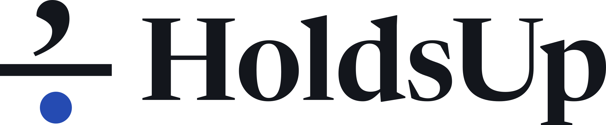
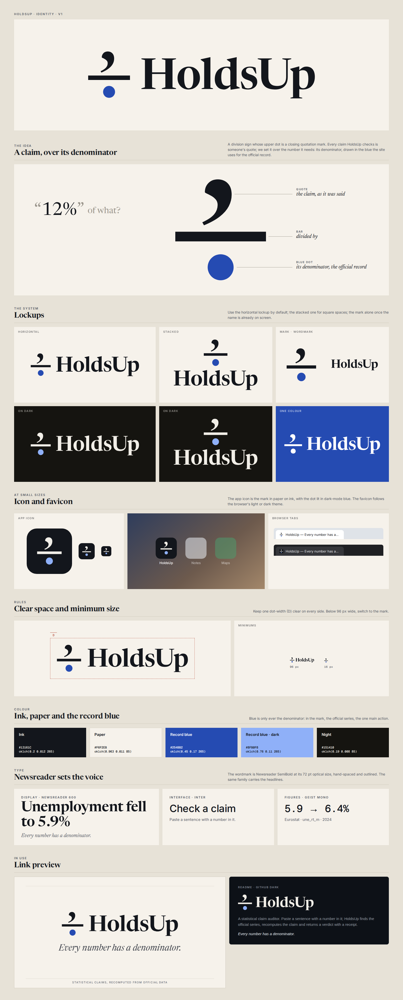

<picture>
  <source media="(prefers-color-scheme: dark)" srcset="holdsup-logo-dark.svg">
  
</picture>

# HoldsUp brand

**The idea.** The mark is a division sign whose upper dot is a closing quotation mark: a claim,
set over its denominator. Every claim HoldsUp checks is someone's quote, and the one thing it
always asks is _"out of what?"_ The denominator is the only blue in the logo, the same blue the
site uses for the official record.



## Files

| File | Use it for |
| --- | --- |
| `holdsup-logo.svg` | The default logo (mark + wordmark) on light backgrounds |
| `holdsup-logo-dark.svg` | The same on dark backgrounds |
| `holdsup-logo-stacked.svg`, `-dark` | Square-ish spaces: mark above the wordmark |
| `holdsup-mark.svg`, `-dark` | The mark alone, once the name is already on screen |
| `holdsup-wordmark.svg`, `-dark` | The name alone, where the mark would repeat |
| `*-mono.svg` | One colour (`currentColor`): set the colour from CSS |
| `favicon.svg` | Browser tab icon; switches to light ink in dark mode |
| `favicon.ico` | Fallback tab icon (16, 32, 48 px, ink tile) |
| `apple-touch-icon.png`, `holdsup-app-icon-*.png`, `holdsup-app-icon.svg` | Home-screen and PWA icons (full bleed; the OS rounds the corners; the mark sits inside the maskable safe zone) |
| `holdsup-logo.png`, `holdsup-logo-dark.png`, `holdsup-mark-512.png` | Raster copies for places that don't take SVG |
| `holdsup-social.png` | 1200×630 link preview |

All SVGs are outlined: they need no font and render the same everywhere, GitHub included.

## Rules

- **Clear space:** one dot diameter (D) on every side of the logo.
- **Minimum size:** the logo at 96 px wide; below that, use the mark (works down to 16 px).
- **Colour:** keep the dot blue and everything else ink. On dark backgrounds use the `-dark`
  files (paper ink, light record blue). For a single colour, use `-mono`.
- **Don't** recolour the quote or the bar, separate the quote from the bar, put a light-mode
  file on a dark background, or re-typeset the wordmark from the font: the outlines are
  hand-spaced.

## Colour

| Name | Hex | OKLCH |
| --- | --- | --- |
| Ink | `#13161C` | `oklch(0.2 0.012 265)` |
| Paper | `#F6F2EB` | `oklch(0.963 0.011 85)` |
| Record blue | `#254BB2` | `oklch(0.45 0.17 265)` |
| Record blue, dark | `#8FB0F8` | `oklch(0.76 0.11 265)` |
| Paper ink (on dark) | `#F1EEE7` | `oklch(0.95 0.01 85)` |
| Night | `#151410` | `oklch(0.19 0.008 85)` |

## Type

The wordmark is **Newsreader SemiBold** at its 72 pt optical size, tracked −1.9% with
measured pair spacing, then converted to outlines. The quote in the mark is Newsreader's own
right quotation mark, so the mark and the name share one drawing. The site sets its headings,
claims and big figures in the same family (the variable font, so each size gets its own
optical cut); Inter is the interface face, Geist Mono the code, and Caveat the editor's pen.

## In the web app

| Where | What |
| --- | --- |
| `apps/web/src/lib/logo-art.ts` | The logo as one ink path and one dot, for the inline `LogoLockup` atom (header, footer, embed) and the share pictures |
| `apps/web/src/app/icon.svg`, `favicon.ico`, `apple-icon.png` | Copies of `favicon.svg`, `favicon.ico` and `apple-touch-icon.png` |
| `apps/web/src/app/(site)/check/[id]/og-card.tsx` | The share pictures (a check's receipt, and the brand card every other page uses) |
| `apps/web/assets/og/` | Static, Latin-only cuts of Newsreader and Inter for the share pictures, with their licences |

If the logo changes, regenerate all four from the new master.

## In a README

```html
<picture>
  <source media="(prefers-color-scheme: dark)" srcset="brand/holdsup-logo-dark.svg">
  
</picture>
```

## Credits

Newsreader by Production Type, licensed under the SIL Open Font License 1.1.
